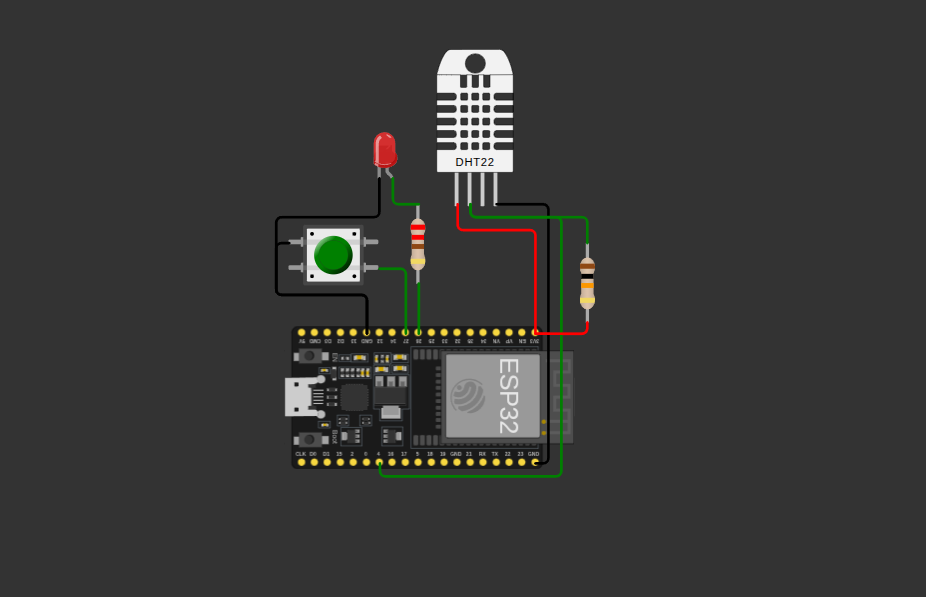
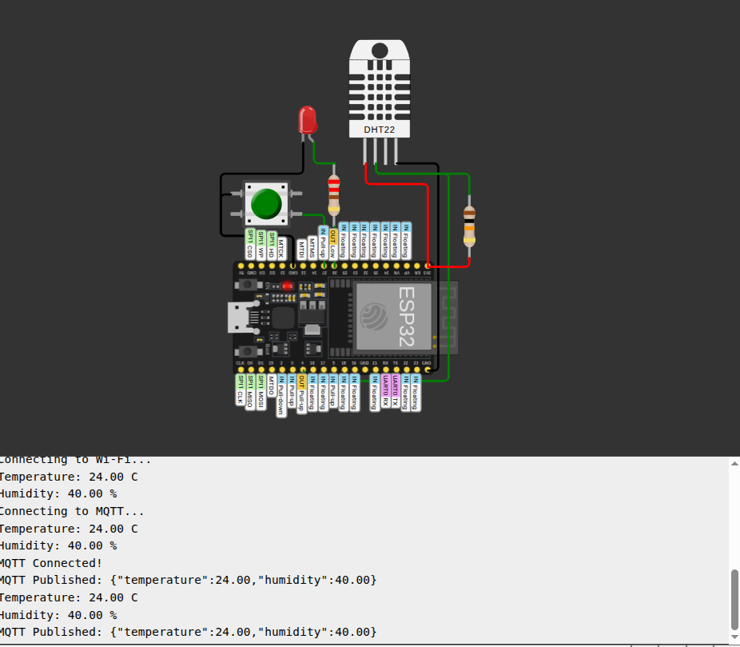
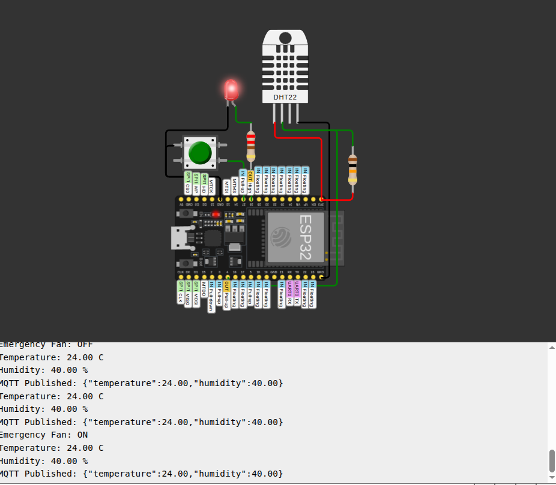

# Simulation Results

## Simulation Platform
Wokwi ESP32 simulation.

## Simulated Hardware
- ESP32 DevKit
- DHT22 temperature and humidity sensor
- Pushbutton
- LED used as the cooling-fan indicator
- 220 Ω LED series resistor
- 10 kΩ DHT22 data pull-up resistor

## Verified Behavior

1. The ESP32 starts the firmware.
2. The DHT22 returns temperature and humidity readings.
3. The ESP32 connects to the `Wokwi-GUEST` Wi-Fi network.
4. The MQTT client connects to `broker.hivemq.com:1883`.
5. Temperature and humidity are published to the configured MQTT topic in JSON format.
6. Pressing the emergency button toggles the fan LED ON and OFF.

## Evidence Screenshots
| Image | Description |
|---|---|
|  | Complete simulated circuit. |
|  | Sensor readings, Wi-Fi and MQTT operation. |
|  | Emergency fan ON/OFF operation. |

## Limitations

- No physical hardware test result is claimed.
